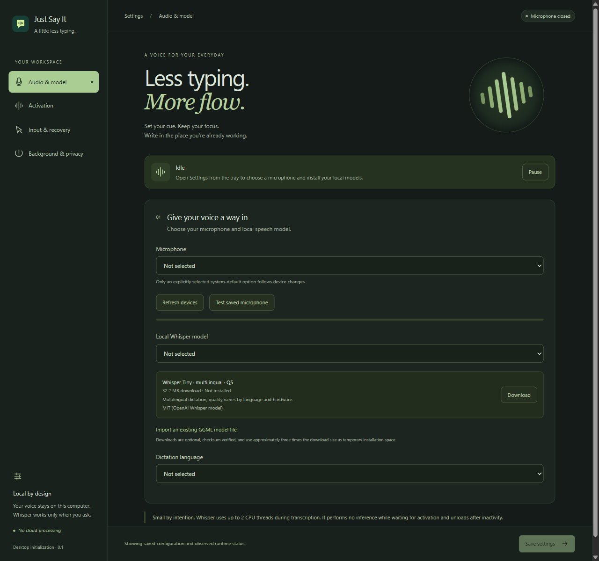
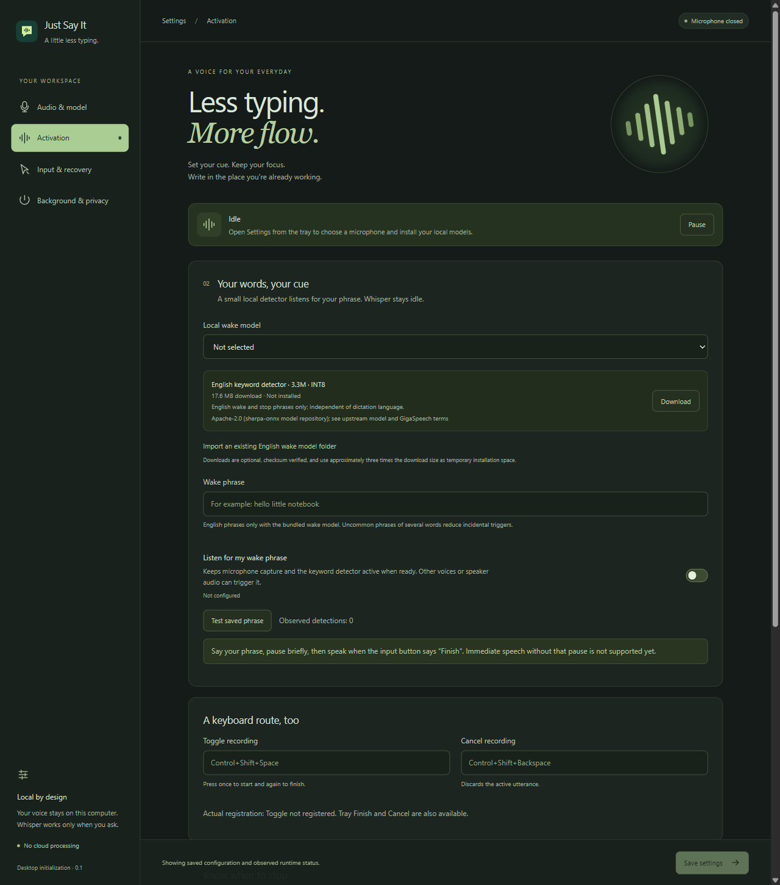
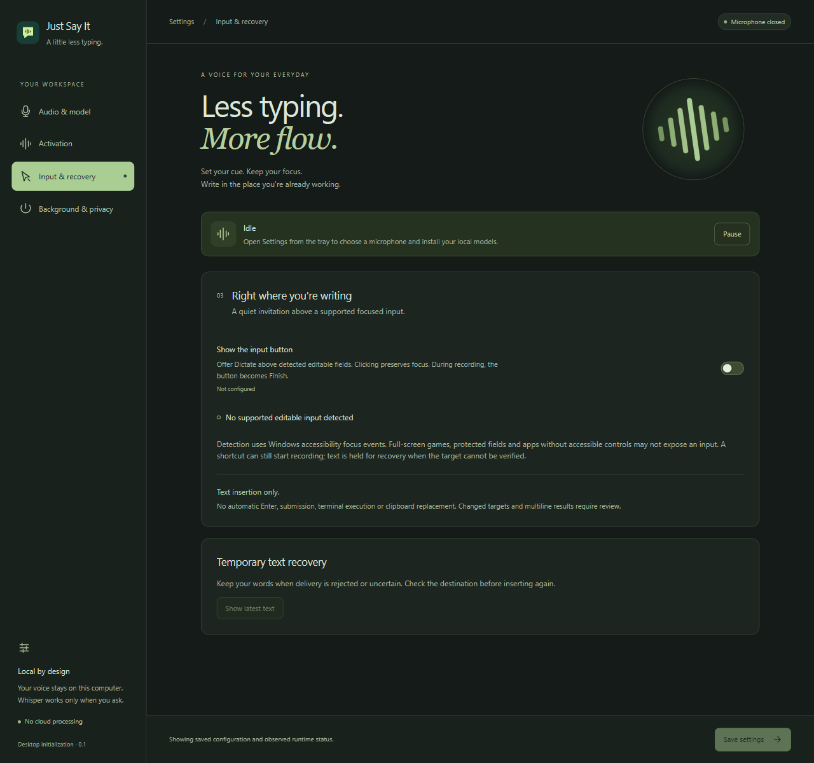
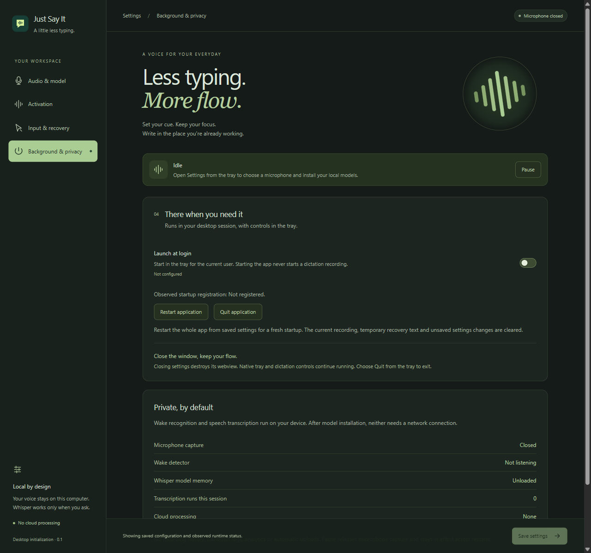

<p align="center">
  
</p>

<h1 align="center">Just Say It</h1>
<p align="center"><strong>Less typing. More flow.</strong></p>
<p align="center">Local desktop dictation for the place you're already writing.</p>

<p align="center">
  <a href="#how-it-works">How it works</a> ·
  <a href="#get-started">Get started</a> ·
  <a href="#download">Download</a> ·
  <a href="#built-to-stay-light">Performance</a> ·
  <a href="#development">Development</a>
</p>

Just Say It turns speech into text inside a supported, focused input. Say your chosen wake phrase, use a keyboard shortcut, or click the small input button. Speak, finish the recording, and let local Whisper transcription do the typing.

**Current build: Windows x64 preview.** The native Windows application is implemented and has recorded desktop checks. macOS and Ubuntu adapters remain unfinished. See [current status](#current-status) for the evidence and limits.

<picture>
  <source media="(prefers-color-scheme: dark)" srcset="docs/images/audio-dark.png" />
  <source media="(prefers-color-scheme: light)" srcset="docs/images/audio-light.png" />
  
</picture>

*The actual Windows development interface, captured with first-run preferences unset and microphone capture closed. The screenshots show the app's supported light and dark palettes.*

## Why it exists

Writing a message, filling out a form, or taking notes often means stopping to type. Just Say It reduces that keyboard work by putting spoken words into the field you're already using. You can keep working in your browser or desktop application while dictation stays available from the tray.

Local processing and resource use are central to the design. Whisper does not run continuously to search for a command. Optional voice activation uses a separate, small keyword detector; the speech model transcribes after an activated recording finishes.

## What you get

| Capability | What it does |
| --- | --- |
| Your own activation phrase | Configure an English wake phrase without training a new model for each phrase. |
| Three ways to start | Use your saved wake phrase, a registered toggle shortcut, or the floating input button. |
| Local multilingual transcription | Run Whisper on your computer with a selected language or explicitly chosen automatic language detection. |
| An input button that keeps your focus | Offer **Dictate** above supported focused inputs; change it to **Finish** while recording. Detecting a field alone never starts capture. |
| Temporary text recovery | Review the latest result when insertion is rejected or uncertain, then deliberately choose another input or copy it manually. |
| A native tray app | Close Settings while the runtime stays available. Optional login startup runs in your desktop session. |
| Clear listening controls | **Pause** releases microphone capture and survives restarts. **Restart application** and **Quit application** are available in Settings and the tray. |
| System-aware appearance | Follow the native light or dark theme, with a dark fallback when the theme cannot be determined. |

## How it works

1. **Focus an input.** Place your caret in a supported browser field, editor, or other accessible text control.
2. **Activate.** Say your saved phrase, press your toggle shortcut, or click **Dictate** above the field.
3. **Speak.** Wait for recording to begin. When using a wake phrase, pause briefly after the phrase before dictating.
4. **Finish.** Click **Finish**, press the toggle shortcut again, use the tray, or use an enabled stopping rule.
5. **Get your text.** Audio capture stops and Whisper transcribes locally. The app rechecks the destination before attempting insertion. If it cannot safely use that target, the words remain temporarily available in recovery.

Text appears after the recording is finished; this build does not stream words into the field as you speak. It inserts text without pressing Enter or submitting a form.

## Get started

### Open the desktop app

Download the [Windows installer](#download), or run the application from source using the [development instructions](#development). Models are separate downloads; they are not included in the installer.

Ordinary launch goes to the tray. Open **Settings** from the tray menu. Launching a second instance opens the existing instance's Settings. You can also pass `--settings` to the executable to open the window immediately.

### 1. Choose your audio and speech model

In **Audio & model**, shown above:

1. Choose your **Microphone**. **Follow system default** is an explicit choice if you want the app to use the current default device when opening capture.
2. Download the catalog Whisper model, or import a compatible local GGML model file.
3. Select that model in **Local Whisper model**. Downloading it does not select it automatically.
4. Choose a **Dictation language**, or deliberately select automatic detection.
5. Click **Save settings**, then **Test saved microphone** to check the observed input level.

The microphone test runs for 15 seconds without speech recognition. If the app is paused, use **Resume** before testing. Fields begin unset; placeholders are examples, not saved configuration.

### 2. Set your activation cue

Open **Activation**. For voice activation, download or import the supported English wake model, select it, enter your **Wake phrase**, enable **Listen for my wake phrase**, and save. Use **Test saved phrase** to check detections without starting a dictation session.

Choose an uncommon phrase of several words. The current keyword model supports English phrases even when your dictation language is different. Other voices or audio from speakers can trigger it; it does not identify your voice.

You can also save **Toggle recording** and **Cancel recording** shortcuts here. The UI reports actual shortcut registration separately from saved values. Optional stop phrases, silence timing, and recording limits are further down the page.

**For this build, say the wake phrase, pause briefly, then speak when recording begins. Immediate speech joined to the phrase is not supported yet.**

<details>
<summary>See the Activation interface</summary>



</details>

### 3. Enable the input button

In **Input & recovery**, enable **Show the input button** and save. Focus a supported text field in another app: **Dictate** appears above it. Clicking the button preserves the field's focus. During recording it becomes **Finish**.

If the destination changes, is protected, or cannot be verified, automatic insertion is refused. Open **Show latest text** to review a recoverable result. Check whether any text already arrived before choosing **Choose a new input** or copying manually. Temporary text expires after five minutes and clears on pause or exit.

Full-screen games and controls without accessible input information may not expose a field. They do not get blind automatic insertion. The app's own Settings fields are excluded as dictation destinations.

<details>
<summary>See the Input & recovery interface</summary>



</details>

### 4. Choose your background behavior

In **Background & privacy**, enable **Launch at login** only if you want it, then save. The observed startup registration is shown separately. Starting the app never starts a dictation recording; previously enabled wake listening can resume only when ready and not paused.

| Action | Result |
| --- | --- |
| Close Settings | Destroy the settings webview and keep the native tray/runtime available. |
| Cancel a recording | Discard the utterance; configured wake listening may resume. |
| Pause | Cancel active work, clear temporary text, close microphone capture, and remain paused across restarts until **Resume**. |
| Restart application | Relaunch from saved settings and retain installed models. Clear the recording, temporary recovery text, and unsaved edits. |
| Quit application | Exit the application and release capture and shortcuts. |

The privacy panel shows actual microphone, keyword-detector, and Whisper-memory status, plus the number of transcription runs in the current process.

<details>
<summary>See the Background & privacy interface</summary>



</details>

## Built to stay light

The runtime uses Rust, Tauri 2, native microphone capture, and a native input button. React and TypeScript provide the Settings interface. Closing that window destroys its webview.

- Wake listening uses a separate INT8 keyword model with one inference thread.
- Whisper loads after activation, transcribes after recording finishes using two CPU threads, and unloads after inactivity. Selecting a model validates loading but does not retain it for idle use.
- Audio callbacks use a preallocated, bounded ring. Inference, downloads, and filesystem work stay outside the audio callback and UI thread.
- Input detection follows Windows accessibility focus events instead of scanning the screen.

Initial observations on a Windows 11 / Intel Core i9-9900K reference machine:

| Mode | Observed working set | Observed CPU | Measurement |
| --- | --- | --- | --- |
| Tray idle, wake listening off | 21.15 MiB | 0.00521% of one logical core | Installed release, five minutes; no descendant processes. |
| Wake listening on, Whisper unloaded | 96.1 MiB | 4.74% of one logical core | Native development process with the release keyword engine, 30 seconds; excludes other processes. |

These are initial-build observations, not a guarantee for every machine or a new benchmark of later UI/restart changes. Settings-open memory, battery use, transcription latency, and long-term session stability need separate measurements. See the [validation record](docs/validation.md) for the environment and full evidence.

## Your voice stays local

Wake recognition and speech transcription run on the device. Once models are installed, both work without a network connection. Model downloads contact their listed upstream sources only when requested.

The app has no cloud transcription, account system, analytics, automatic diagnostic uploads, or recording/transcript history. It keeps only bounded temporary audio for the current operation and the latest text for short-lived recovery. Dictation does not automatically replace clipboard contents, press Enter, send messages, or execute terminal commands.

When wake listening is enabled and ready, the microphone is open for keyword detection. **Pause** is the control that releases capture and keeps listening off across restarts.

## Current status

This is an initial Windows implementation, not the completed cross-platform release in the [project specification](project%20initialization.md).

| Target or capability | Status |
| --- | --- |
| Windows 11 x64 | Native implementation with recorded microphone, model, desktop, UI, packaging, theme, and restart checks. |
| Windows native inputs and Microsoft Edge | Dedicated editor, browser-input, and contenteditable fixtures received Unicode; changed and protected targets were exercised. This is not a universal application compatibility claim. |
| Live human wake-to-typing accuracy | Still needs broader end-to-end testing, including accents, noise, competing voices, and speaker audio. |
| macOS Apple Silicon and Intel | Native insertion/input detection and desktop validation remain unfinished. |
| Ubuntu X11 and Wayland | Native input adapters and desktop validation remain unfinished; these are separate compatibility cases. |
| Hold-to-talk | Unfinished; current shortcuts use toggle and cancel. |
| Public distribution | Windows preview installer is available from [GitHub Releases](#download) and is unsigned. Signing, complete distribution-license review, and the full release acceptance matrix remain outstanding. |

See [compatibility](docs/compatibility.md) for platform boundaries and [validation](docs/validation.md) for checks actually performed. Immediate post-wake speech, comprehensive stop-command handling, actual login/lock/suspend scenarios, games, elevated apps, keyboard layouts/IME, and settings-preserving upgrades still need their acceptance evidence.

## Download

**[Download the Windows x64 preview installer](https://github.com/mlnima/just-say-it/releases/download/v0.1.0/Just.Say.It_0.1.0_x64-setup.exe)** · [Release notes and checksums](https://github.com/mlnima/just-say-it/releases/tag/v0.1.0) · [All releases](https://github.com/mlnima/just-say-it/releases)

Run the downloaded `-setup.exe`, then open Settings from the tray. The installer includes the native inference libraries; users do not need the source code or development tools. Models are downloaded separately in Settings. If WebView2 is missing, setup may need an internet connection to install it.

This preview is **unsigned**, so Windows may show an unknown-publisher or SmartScreen warning. The release includes a `SHA256SUMS` file for checking the download; a checksum is not a publisher signature. See the [release notes](docs/release-notes.md) and [validation record](docs/validation.md) for current limits.

| Platform | Download status |
| --- | --- |
| Windows x64 | NSIS `-setup.exe` preview installer. |
| Ubuntu | `.deb` is the intended installer format; native input adapters and desktop validation remain unfinished, so no Linux download is published. |
| macOS Apple Silicon / Intel | `.dmg` is the intended download format; native input adapters and desktop validation remain unfinished, so no Mac download is published. |

## Development

### Prerequisites

The documented development environment is Windows 11 x64 with:

- Visual Studio 2022 C++ desktop tools and a Windows SDK.
- CMake and the pinned Rust **1.95.0** toolchain.
- Node.js **24.19.0** and npm **11.6.1**.
- Python for the development-only libclang package used to generate native bindings.

End users do not need Python, Node.js, Rust, or CMake.

From the repository root:

```powershell
npm ci
python -m pip install --target artifacts/build-tools libclang==18.1.1
npm run desktop
```

`scripts/build-environment.mjs` discovers installed MSVC and Windows SDK headers. On Windows it uses the checkout-relative development libclang directory when present; an explicit `LIBCLANG_PATH` takes precedence. Other systems use their installed libclang without a Windows-specific path override. `.cargo/config.toml` disables build-host CPU tuning for Whisper. Use the provided wrappers for native commands. `.node-version`, `packageManager` in `package.json`, and `rust-toolchain.toml` pin the development tool versions.

### Build and check

| Command | Purpose |
| --- | --- |
| `npm run build` | Strict TypeScript check and production frontend build. |
| `npm run test:core` | Desktop-independent core tests. |
| `node scripts/cargo.mjs test --workspace` | Workspace tests; real-device/model/desktop tests remain ignored unless explicitly enabled. |
| `npm run check:files` | Verify that each authored code file contains fewer than 300 lines. |
| `node --test scripts/tests/build-environment.test.mjs` | Check actual tool discovery and explicit environment overrides. |
| `npm run package` | Build a Windows NSIS test installer with its matching native inference libraries. |
| `node scripts/package.mjs --no-bundle` | Build the release executable and adjacent native libraries without an installer. |

The Windows installer is written to `target/release/bundle/nsis/Just Say It_0.1.0_x64-setup.exe`. Packaging does not publish or sign it. Keep the adjacent native DLLs with an unpackaged executable. Quit a running development app before rebuilding native dependencies because Windows locks loaded DLLs.

Windows packaging discovers Cargo's actual output directory, including `CARGO_TARGET_DIR`, and uses the selected `--target` and `--debug` options for the installer and its native DLLs. To pass options reliably from PowerShell, invoke the script directly. Cargo arguments follow `--`, for example `node scripts/package.mjs --ci -- --locked`.

### GitHub releases

The [build workflow](.github/workflows/build.yml) runs on fresh Windows runners for branch pushes and pull requests. It installs the pinned tools, checks file sizes and build tooling, runs workspace tests, and builds an installer. Real microphone/model/desktop tests remain separate, with prerequisites documented below. The workflow saves the installer, notices and SHA-256 checksum as a build artifact.

To publish a Windows preview, update the matching versions in `package.json`, `package-lock.json`, `src-tauri/Cargo.toml`, `Cargo.lock`, and `src-tauri/tauri.conf.json`, update the download links and release notes, commit and push, then push the corresponding `v<version>` tag. For the current version:

```powershell
git tag v0.1.0
git push origin v0.1.0
```

Only a successful tagged build publishes a GitHub **prerelease** with the installer and checksums. The tag must match the frontend, native package and Tauri versions. Publishing uses the repository's built-in Actions token with write permission limited to the release job. No personal token or computer-specific path belongs in the workflow. Reusing an existing release tag fails instead of replacing downloads silently.

This follows [Tauri's GitHub distribution guidance](https://v2.tauri.app/distribute/pipelines/github/) and [GitHub Releases](https://docs.github.com/en/repositories/releasing-projects-on-github/about-releases). macOS and Ubuntu releases require completion and verification of their native functionality before adding those packages to the release workflow.

Real adapter and desktop tests require the catalog models, locally generated speech fixtures, a real microphone, Microsoft Edge, Playwright, and an unlocked idle desktop:

```powershell
powershell.exe -NoProfile -File tests/desktop/generate-audio.ps1
# Place the catalog models in artifacts/models; see docs/validation.md.
# Set PLAYWRIGHT_MODULE_PATH if Playwright is supplied externally.
node scripts/cargo.mjs test --workspace -- --include-ignored --test-threads=1
```

Do not type while these tests own their dedicated fixture windows. They verify the fixture process before dispatching text. The wrapper copies matching ONNX libraries beside the test executables; models, audio, browser profiles, and build output stay under ignored directories. Additional theme, restart, settings, runtime, and download checks are documented in the [validation record](docs/validation.md).

### Configuration and source map

Saved Windows preferences live at `%APPDATA%\app.justsayit.desktop\settings.json`. Installed models use the OS application data directory. Settings are versioned and written atomically. Invalid or unreadable existing settings are preserved and block overwriting until recovered deliberately.

| Location | Responsibility |
| --- | --- |
| `crates/dictation-core` | Provider-independent settings, session, authorization, and speech-activity rules. |
| `src-tauri/src` | Audio, activation, local models, native platform adapters, delivery, tray, and lifecycle. |
| `src` | Typed command/event bridge and the Settings/status/recovery UI. |
| `crates/dictation-core/src/defaults.rs` | Shared runtime fallback policies, limits, and timings. |
| `src-tauri/tauri.conf.json` | Application identity and desktop configuration. |
| `src-tauri/model-catalog.json` | Pinned model sources, sizes, checksums, licenses, and language metadata. |
| `tests/desktop` | Dedicated desktop fixtures and real-runtime UI checks. |
| `docs` | Decisions, compatibility, validation, notices, and README screenshots. |

Rust owns runtime state and validation. New speech providers and optional text processing belong behind small explicit interfaces; roadmap items do not imply implemented features. See the [implementation decisions](docs/decisions.md) and [agent instructions](AGENTS.md) before making changes.

## License and notices

An application license has not been selected. See [third-party notices](docs/THIRD-PARTY-NOTICES.md) for component attribution and distribution-review status. Models are optional separate downloads with their own license information shown in the interface.
